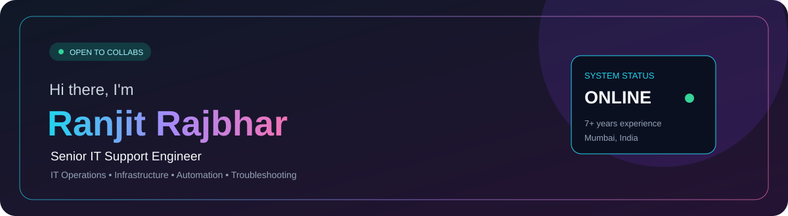
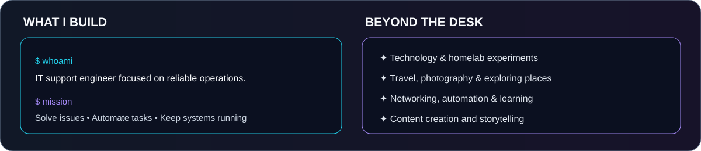
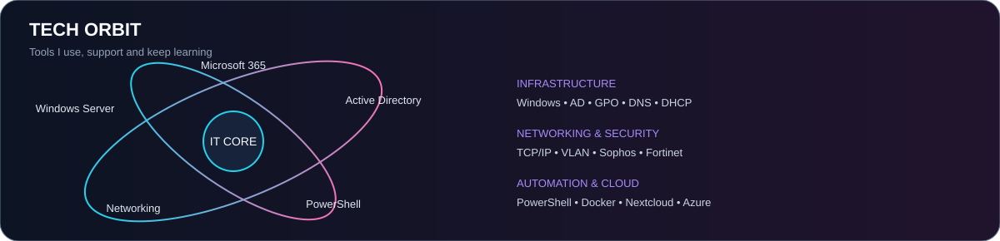
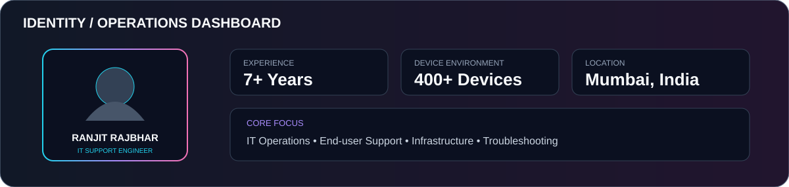
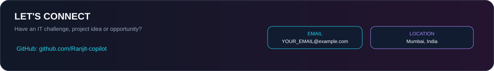

# Ranjit Rajbhar — Animated GitHub Profile

## Featured Projects

| Project | Description |
|---|---|
| [IT Support Toolkit](https://ranjit-copilot.github.io/IT-Support-Toolkit/) | IT support utilities and resources |
| [Life Story](https://ranjit-copilot.github.io/Life-Story/) | Personal storytelling website |
| Nextcloud Cloud Library | Self-hosted cloud and digital library |
| Windows Recovery Repair Toolkit | Windows troubleshooting toolkit |

## About
I'm Ranjit Rajbhar, a Senior IT Support Engineer with 7+ years of experience in end-user support, Windows environments, Active Directory, networking, ITSM and infrastructure operations.

**Currently learning:** CCNA, Windows Server, PowerShell automation, Microsoft 365, Entra ID and Intune.

**Location:** Mumbai, India · **GitHub:** [Ranjit-copilot](https://github.com/Ranjit-copilot)

> Edit `connect.svg` to add your public email address before publishing.
